

  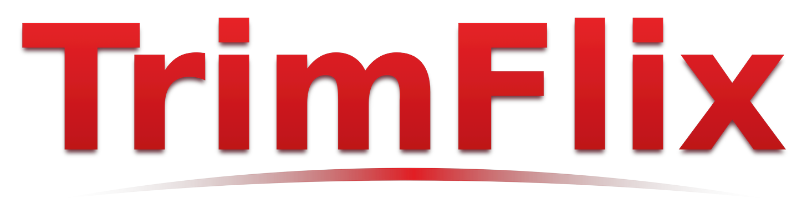

  

    <b>Le lecteur IPTV pensé pour la télé, le téléphone, la tablette et le PC.</b>
     
    TV en direct • Replay • Films • Séries • Sport • Suivi Trakt / Simkl / Scrob
  

  

    <a href="https://github.com/TrimVa/TrimFlix-releases/releases/latest/download/trimflix.apk"><b>⬇️ Télécharger l'APK (Android TV, téléphone, tablette)</b></a>
  

  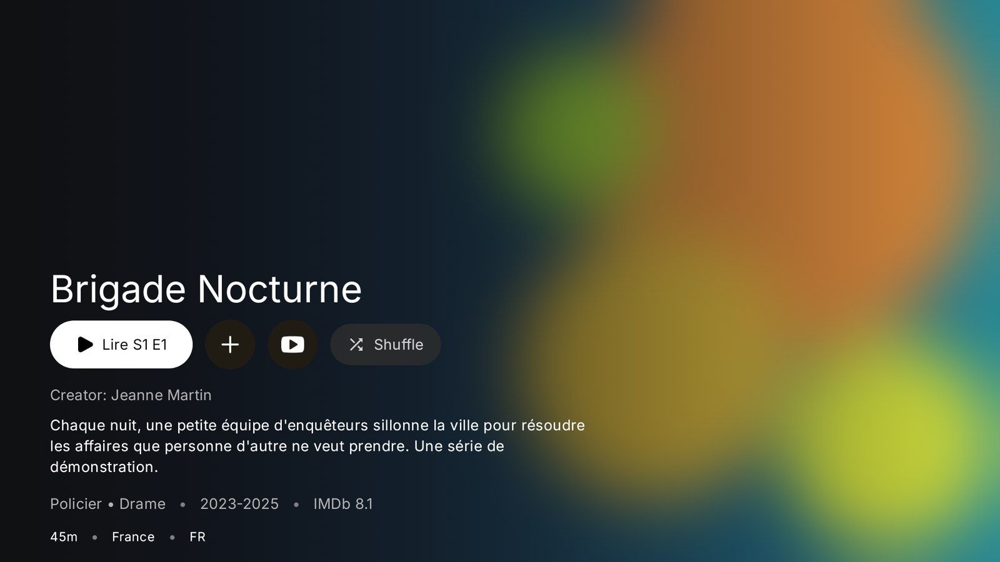
   <i>Fiche d'une série sur Android TV</i>

## Présentation

TrimFlix lit **votre propre abonnement IPTV** (playlist Xtream ou M3U) dans une interface moderne, inspirée des
plateformes de streaming : affiches, résumés, bandes-annonces, reprise de lecture et rangées personnalisables.

Une seule application Android s'adapte à l'appareil :

| Appareil | Utilisation |
| --- | --- |
| 📺 **Android TV / Google TV** (Shield, box, téléviseurs) | Télécommande, interface pleine largeur avec barre latérale |
| 📱 **Téléphone** | Tactile, portrait avec barre d'onglets en bas (paysage = interface TV) |
| 📲 **Tablette** | Tactile, portrait ou paysage |
| 💻 **PC Windows et Linux** | Clavier et souris, même présentation que la TV (application séparée, voir plus bas) |

> TrimFlix ne fournit aucun contenu. L'application lit uniquement les playlists auxquelles l'utilisateur est abonné
> ou qu'il a le droit d'utiliser.

## Fonctionnalités

### 📡 TV en direct et Replay
- Chaînes rangées par groupes, favoris, recherche, zapping haut/bas.
- **Guide des programmes** (EPG) : programme en cours, suivant, barre de progression et grille horaire.
- **Replay** sur les chaînes qui le proposent et **enregistrements**.
- L'ordre de la playlist, les sections et les mises à jour se règlent dans *Paramètres > Live TV*.

### 🎬 Films et 📺 Séries
- Catalogues de la playlist enrichis avec **TMDB** : affiches, résumés, notes, genres, distribution, en français par défaut.
- Fiche détaillée avec saisons, épisodes, choix de la source (langue, qualité).
- **Reprise de lecture** et rangée « À suivre » pour l'épisode suivant.
- Audio français et sous-titres forcés par défaut, lecteur avancé (formats HDR, pistes audio et sous-titres).

### ⚽ Sport
- Matchs à venir et résultats par compétition, avec les chaînes qui les diffusent.

### ✅ Suivi Trakt, Simkl et Scrob
- Connexion par QR code ou par code.
- Progression synchronisée (« Reprendre », « À suivre »), watchlist, marquage vu, notes.
- Choix de la source de progression et de bibliothèque dans *Paramètres > Suivi*.

### 👨‍👩‍👧 Profils et contrôle parental
- Plusieurs profils par appareil, chacun avec ses réglages et sa progression.
- **Code parental** pour protéger les réglages et les profils.
- Réglages, profils et lectures en cours partagés entre vos appareils.

### 🏠 Accueil personnalisable
- Réordonner ou masquer chaque rangée (*Paramètres > Disposition > Organiser l'accueil*).
- Recherche et page « Découvrir » par type, catalogue et genre.

### 🛠️ Pratique
- **Mise à jour intégrée** : l'application propose elle-même les nouvelles versions.
- **Signaler un problème** depuis l'application ; les plantages sont remontés automatiquement pour être corrigés.
- Une playlist refusée ou injoignable est signalée automatiquement au revendeur (abonnement expiré : « Contactez votre revendeur »).
- Réglages réseau (DNS sécurisé, IPv4 uniquement) pour les connexions difficiles, appliqués aussi à la TV en direct.
- **Mode box légère** (réglages de lecture) pour les petites box ; les autres box utilisent plus de mémoire pour les films 4K et Dolby Vision.

## Captures d'écran

### 📱 Téléphone

  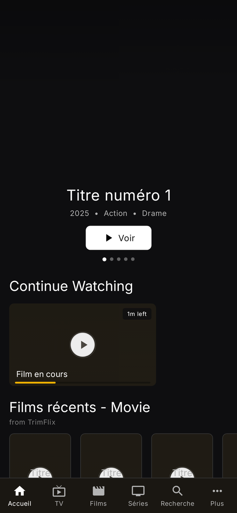
  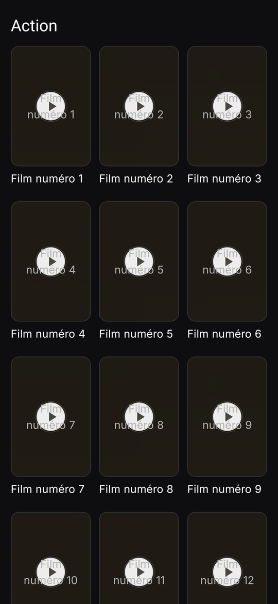
  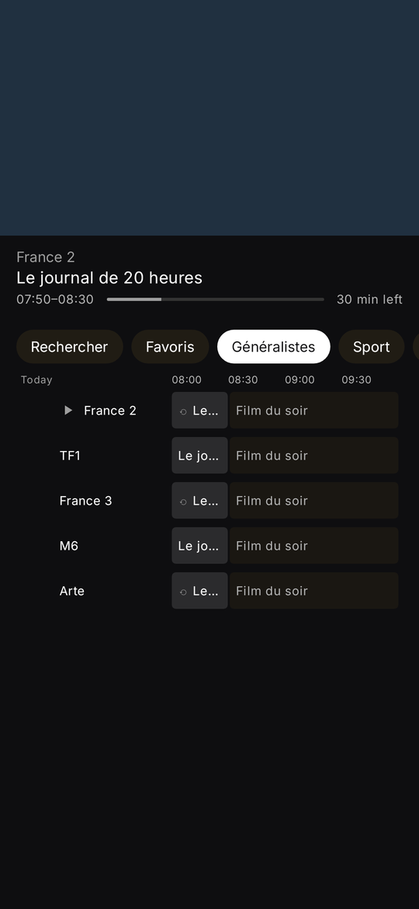
  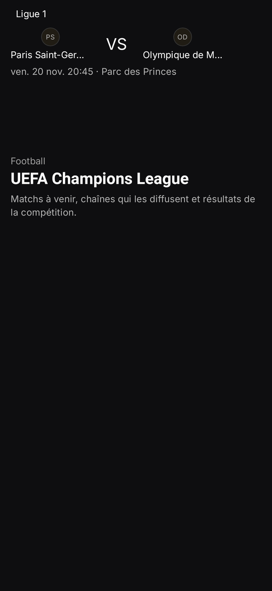

  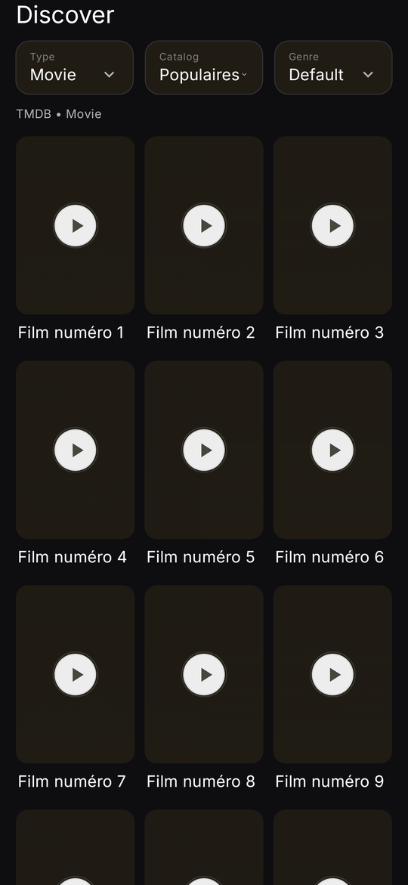
  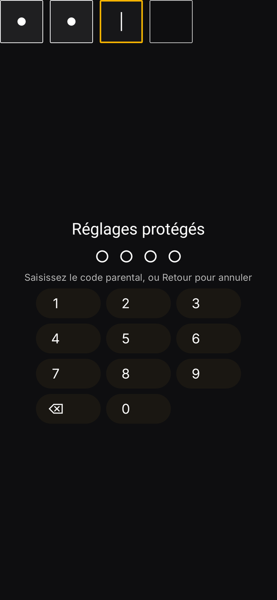

  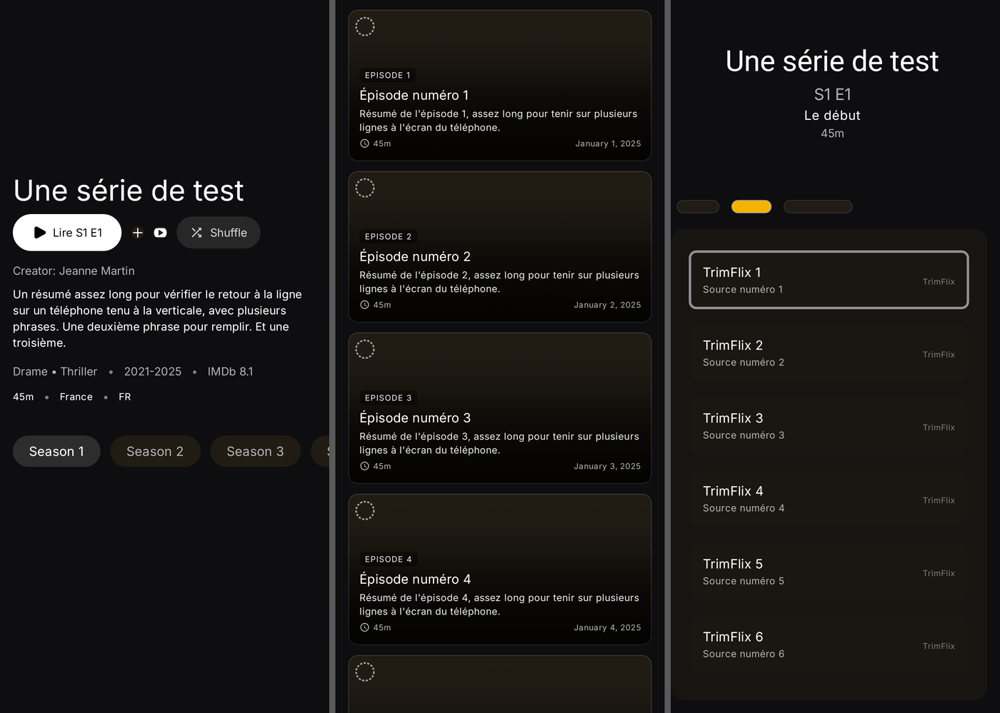
   <i>Fiche d'une série : présentation, épisodes et choix de la source</i>

### 📲 Tablette

  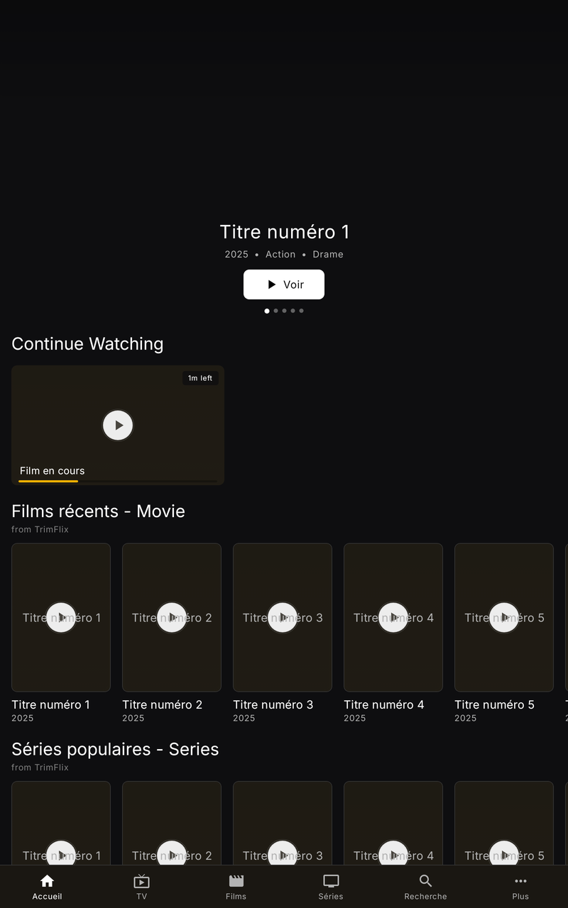

### 💻 PC (Windows et Linux)

  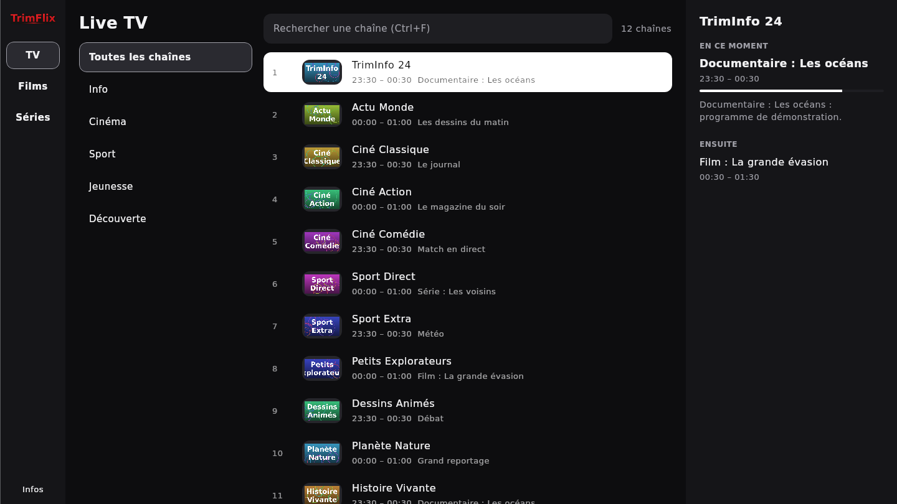
   <i>TV en direct avec le programme en cours et le suivant</i>

  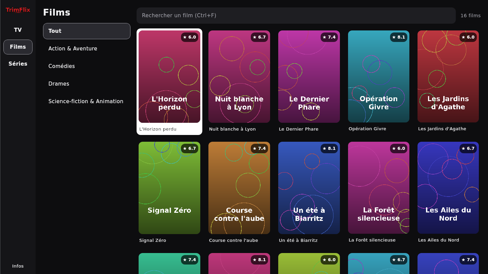
  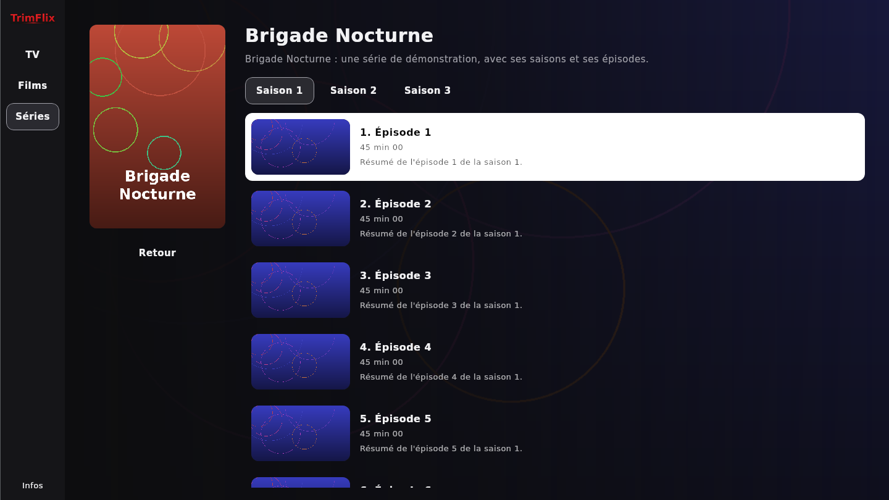

Les captures sont réalisées avec une playlist de démonstration : chaînes, titres et affiches sont fictifs.

## Installation

### Android TV, Google TV, téléphone et tablette

1. Téléchargez la dernière version :
   **[trimflix.apk](https://github.com/TrimVa/TrimFlix-releases/releases/latest/download/trimflix.apk)**
   (ce lien pointe toujours vers la version la plus récente).
2. Sur Android TV, le plus simple est l'application **Downloader** : saisissez le lien ci-dessus et lancez
   l'installation. Sur téléphone, ouvrez le lien dans le navigateur.
3. Autorisez l'installation d'applications inconnues si Android le demande. Un avertissement Play Protect peut
   s'afficher : choisissez « Installer quand même ».
4. Au premier lancement, TrimFlix affiche l'**identifiant de l'appareil**. Communiquez-le à votre fournisseur
   pour que votre abonnement soit activé ; la playlist arrive alors toute seule. Pendant la phase de test,
   vous pouvez aussi ajouter vous-même une playlist Xtream ou M3U.

Les versions suivantes se proposent directement dans l'application.

### PC Windows et Linux

La version PC est une application à part, avec la même présentation que la TV,
au clavier et à la souris : installeur **MSI** pour Windows et paquet **.deb** pour Linux. Elle est en cours de
test (accueil, TV en direct avec guide et Replay, Films, Séries, signalement de problème, demande de titre,
mise à jour intégrée, rangement des playlists synchronisé avec la TV).

Raccourcis : flèches, Entrée et Échap pour naviguer, `Ctrl+F` pour chercher, `F` ou double-clic pour le plein
écran, molette pour le volume, Espace pour la pause.

## Crédits et licence

TrimFlix est basé sur [NuvioTV](https://github.com/tapframe/NuvioTV) (NuvioMedia), via Tuvora TV, et reste
distribué sous licence **GNU GPL v3** (voir la [licence GPL v3](https://www.gnu.org/licenses/gpl-3.0.fr.html)).

## Versions

Toutes les versions et leurs nouveautés sont sur la page [Releases](https://github.com/TrimVa/TrimFlix-releases/releases).
Lien direct vers la dernière APK : https://github.com/TrimVa/TrimFlix-releases/releases/latest/download/trimflix.apk
